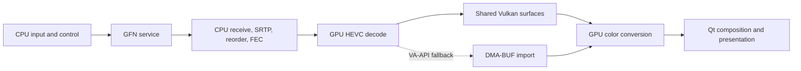

# Evidence-backed Linux GFN prototype plan

## End state of this research phase

Deliver a current protocol map, reproducible observation tools, source reuse
decisions, a buildable native foundation, and an implementation/validation plan.
This phase does not assert that a custom client already improves latency or
certifies all playback behavior. Those claims require the live comparisons below.

The foundation is the user's OpenNOW fork, branch `nucbox-linux-client`, with
native source derived from `bee18c118dbc89f42319436dcdb172d5b9e15e0c`. Its Qt/C++
application, Rust account/session core, and Rust streaming library have built
successfully. The real application opens on the NucBox's X11 desktop. Local
build limits were 4 GiB RAM and two CPU cores; peak build RAM was about 2.9 GiB.

## Protocol and source evidence

The private, checksum-verified official-client trace contains 40,000 complete
packets over 62.02 seconds, with zero reported capture-kernel drops. The analyzer
observed TLS record headers on TCP 322, GS `0x4753` RTP video extensions on
client UDP 49005, and STUN/DTLS on client UDP 49006. Native source supplies the
authenticated SRTP and RTC/control implementation behind those observations.

There are 24,364 video packets, 2,743 sender frame IDs, and 5,628 FEC-coordinate
parity packets. The captured video sequence range has no unseen slots. This
does not establish decryption, FEC repair success, or client-side rendered loss.
733 client-initiated STUN exchanges have median/p95 56.53/57.14 ms; startup
outliers are retained. Router timing excludes the subsequent client Wi-Fi leg.

Encrypted control contents remain opaque in this passive capture. Normal
account/session negotiation is supplied by the open-source client and must be
validated during authorized interoperability testing. OpenNOW's local JSON
protocol versions, including native protocol 7, are not NVIDIA wire versions.

Exa research also identified NEXTCLIENT's Flutter/WebRTC implementation, an older
OpenNOW fork, the archived gfn-electron wrapper, and Moonlight hardware-decoding
material. These are comparison leads. The chosen native transport was checked
against current source and our trace; another GameStream client is not assumed
to be a drop-in GFN client. Exa-indexed OpenNOW Electron descriptions and some
older NACK comparison notes are stale relative to the checked-out Qt/Rust code.

## Architecture to reuse

| Owner | Responsibility | Reason |
|---|---|---|
| Rust application core | Provider sign-in, credentials, entitlements, catalog, CloudMatch, lifecycle | Preserves normal account and service behavior |
| Rust NVST transport | Crypto, ICE/DTLS/SCTP, Mjolnir SRTP, GS metadata, FEC/NACK/recovery | Wire evidence matches this implementation |
| CPU workers | Network receive, reordering/assembly, recovery, audio, input | Explicit owners and observable queues; profile before offloading |
| GPU decoder | HEVC/H.264 hardware decode | AMD driver advertises Main10 VLD; real hardware tests are separate gates |
| GPU frame producer | DMA-BUF or shared Vulkan surfaces, conversion, synchronization | Avoids normal CPU readback; preserves color/layout metadata |
| Qt scene graph | Native texture composition, overlays, input focus, resize/fullscreen | Existing lifecycle and opaque-frame boundary |

The AMD VA-API probe advertises H.264 and HEVC Main/Main10 decode, but no AV1
profile. The native Vulkan Video HEVC P010 hardware test also passed on RADV
RENOIR. Start with that shared-device decode path and validate Qt composition,
then validate the VA-API fallback's separate DMA-BUF import path. Prefer a proven
HEVC GPU path before CPU AV1 or GPU FEC experiments.
Vulkan library presence alone does not prove Vulkan Video support. P010 does
not imply HDR, and GPU conversion plus Qt composition is not direct YUV scanout.

## Milestones and proof gates

1. **Reproduce the baseline.** Use the pinned fork and local toolchain. Build
   `opennow-qt`, verify runtime dependencies, launch with `tools/run-native.sh`,
   and record actual GPU/driver/window-system/backend. Current build and X11
   window startup are verified; that does not prove live playback.
2. **Prove hardware surfaces.** Run `tools/check-hardware.sh` for the existing
   ignored HEVC P010 GPU-only Vulkan Video test. It tests decode, metadata, and
   frame lifetime, not Qt rendering or DMA-BUF import. For VA-API, add a narrow
   account-free probe using `LinuxSession`, H.265/P010, `VaApiOnly`, and embedded
   presentation, then record/submit the existing producer's conversion. Require
   real DMA-BUF output, correct modifiers/pitches/offsets, empty CPU planes,
   matching device ownership, and visible pixel/color correctness. An unsupported
   path is a recorded failure, never a software pass labeled as hardware.

   Current result: the existing Vulkan Video HEVC P010 test passed on RADV
   RENOIR, one test with 196 others filtered out. It decoded a real generated
   256x144 ten-bit frame into GPU-only output and checked metadata/lifetime.
   The VA-API import probe, conversion/composition checks, and full-rate live
   acceptance remain gates for implementing and validating the optimized client.
3. **Instrument the local pipeline.** Correlate sender frame identity and
   receive/assemble/decode/GPU-ready/publish/Qt-submit/swap timestamps. Add queue
   residence and mailbox replacements separately from network loss and decoded
   queue skips. Locally generated GPU-frame IDs currently cannot prove sender
   frame loss. Callback timing is not physical input-to-photon timing.
4. **Run an unchanged live native baseline.** Use normal interactive sign-in,
   then ten-minute sessions on the same game/settings/route/actual rig and 60 Hz
   display. Exercise overlays, focus loss, input releases, window/fullscreen
   resize, shutdown, and restart. Require video inside the one Qt surface, no
   corrupt references, correct 10-bit SDR conversion/dithering, and documented
   fallback behavior. Protect credentials and diagnostic exports.
5. **Test recovery budgets.** Instrument gap detection, NACK admission/send,
   authenticated return, FEC repair, expiry, and keyframe recovery. Test current
   52 ms tracking/dequeue, a paired bounded 68 ms candidate, and an RTT-informed
   candidate. Deterministic local scenarios should span 30/57/80 ms RTT,
   0/4/12 ms jitter, reordering, and 0/0.1/1% loss, with fixed seeds. Preserve
   packet/block/memory limits and healthy-path latency. Do not inject household
   WAN impairment for these unit/replay scenarios.
6. **Test queue and input policies.** Measure the existing compressed queues
   before shrinking them. At 60 FPS, ingress and decoder-command capacities are
   15 and 16 frames; decoded output holds three. Those are capacity calculations,
   not measured latency. Preserve reference recovery on compressed overflow.
   Bound/coalesce the upstream command backlog while preserving key/button
   ordering, releases, text, shutdown priority, and recovery feedback.
7. **Perform matched A/B comparisons.** Run at least three equal-length trials
   per candidate. Record actual server/rig, negotiated codec/depth/chroma/FPS,
   route, display cadence, workload, driver and commit. Compare medians and
   p95/p99 stage/frame age, frozen-display duration, recovery/keyframe counts,
   queue peaks, CPU/GPU use, and memory. Reject comparisons confounded by rig or
   settings changes. A physical latency claim needs a physical measurement.

The native embedded Qt path does not run the standalone `LinuxFramePacer` in
`output.rs`; modifying that pacer alone will not alter desktop presentation.
Start with the existing GPU ownership and measure embedded cadence directly.

## Decision rules

Adopt a change only if the targeted metric improves repeatably without increased
corrupt frames, stuck input, recovery freezes, resource growth, or color loss.
Keep local processing, network RTT, exceptional recovery delay, and display
cadence distinct. A longer loss budget trades recovery against waiting; larger
buffers and extra post-processing are not free latency reductions. GPU FEC and
predictive rendering remain lower-priority hypotheses until profiles justify
their transfer, dispatch, synchronization, and correctness costs.

Private captures and runtime data remain outside Git. The packet analyzer emits
metadata only. Keep hardware tests and normal live diagnostics separate from
public source documentation. The source reviews contain pinned line references:
`transport-review.md` and `gpu-review.md`; `README.md` links the primary sources.
